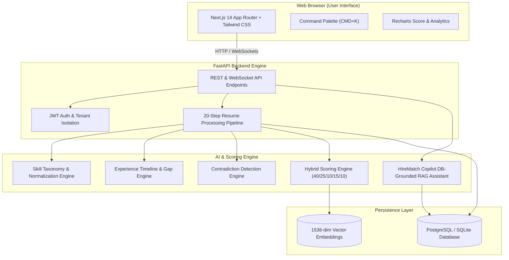

# 🚀 HireMatch AI — Advanced AI Recruitment Intelligence Platform

> **Tagline:** “Turn hundreds of resumes into your smartest shortlist.”

HireMatch AI is a production-quality, hackathon-ready AI recruitment platform designed to transform bulk PDF resume processing into an explainable, evidence-grounded candidate shortlist.

---

## 🏗 System Architecture Diagram



---

## ⚡ Core Features & Capabilities

1. **20-Step Advanced Resume Processing Pipeline**: File validation, hashing, text extraction, OCR fallback, section detection, JSON structured parsing, skill normalization, timeline extraction, project analysis, vector embedding, hybrid scoring, grounded evidence verification, and contradiction detection.
2. **Explainable & Evidence-Grounded AI**: Zero hallucination policy. Every claim links to resume page numbers and verbatim excerpts. Returns "Insufficient evidence" when unverified.
3. **Deterministic Hybrid Scoring Engine**: Configurable weights (Default: 40% Skills, 25% Experience, 10% Education, 15% Projects, 10% Certifications).
4. **Normalized Skill Taxonomy**: Automatic mapping for skill variations (e.g. `React.js` -> `React`, `Postgres` -> `PostgreSQL`, `REST` -> `REST API`, `ML` -> `Machine Learning`).
5. **Timeline & Contradiction Detection**: Identifies unexplained employment gaps (>6 months), overlapping jobs, and tech vs timeline discrepancies (e.g., claiming 8 years Kubernetes experience when first evidence appears in a 2024 project).
6. **HireMatch Copilot**: DB-grounded AI recruiter assistant that answers queries strictly using candidate database records.
7. **Interview Plan Generator**: Automatically generates tailored technical, behavioral, project-specific, and missing-skill probe questions.
8. **Recruitment Analytics & Reports**: Score distribution, missing skill frequency, experience breakdown, plus 1-click CSV & PDF report downloads.

---

## 🔑 Demo Credentials

- **Email:** `recruiter@hirematch.ai`
- **Password:** `password123`

---

## 🛠 Local Setup & Running

### Backend Execution
```bash
cd backend
python -m venv venv
venv\Scripts\activate  # Windows
pip install -r requirements.txt

# Seed Database with Demo Job & Sample Candidates
python -m app.seed

# Run Pytest Test Suite
python -m pytest tests/

# Launch FastAPI Server
uvicorn app.main:app --reload --port 8000
```

### Frontend Execution
```bash
cd frontend
npm install
npm run dev
```
Open [http://localhost:3000](http://localhost:3000) in your browser.

---

## 🐳 Docker Deployment
```bash
docker compose up --build
```
